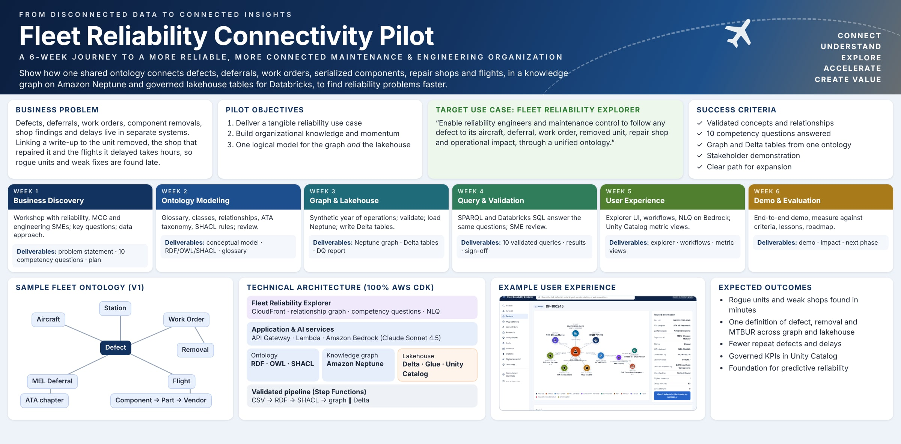
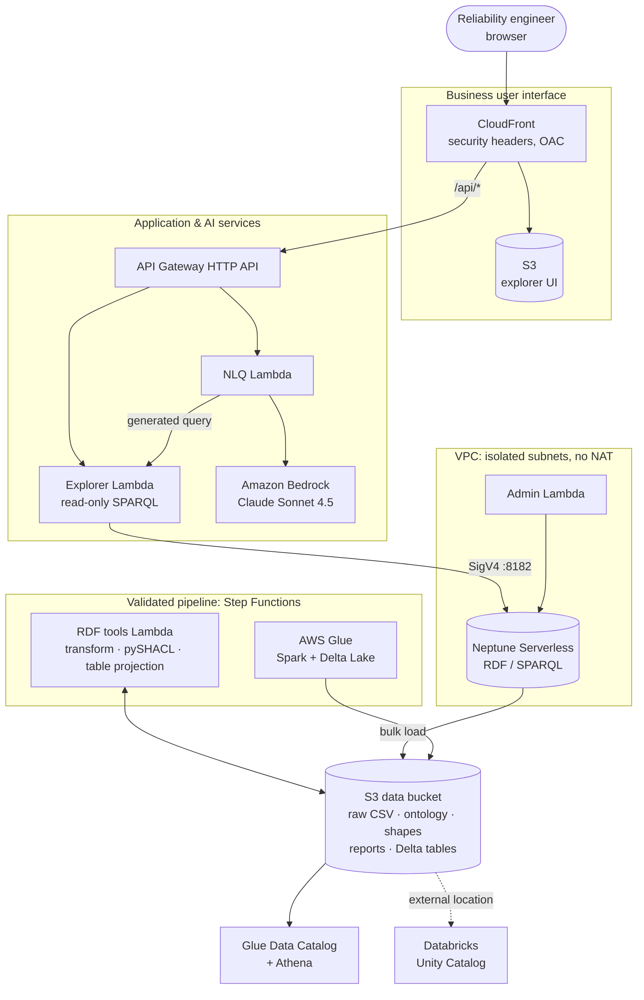
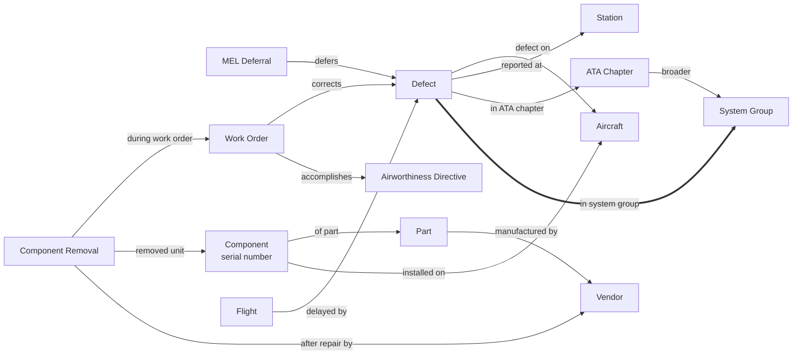
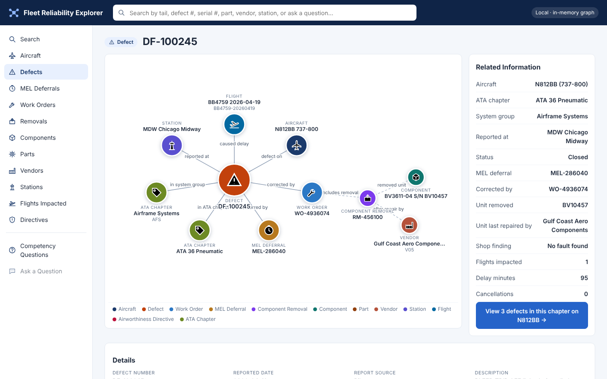
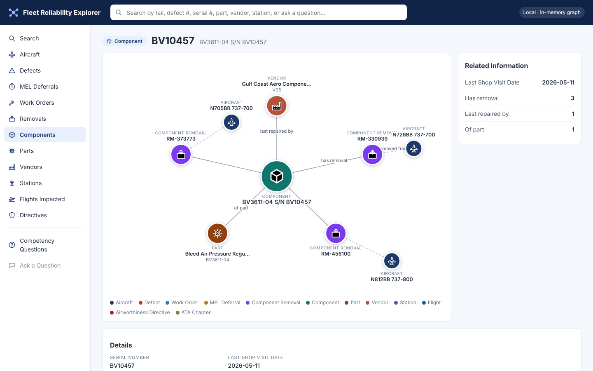
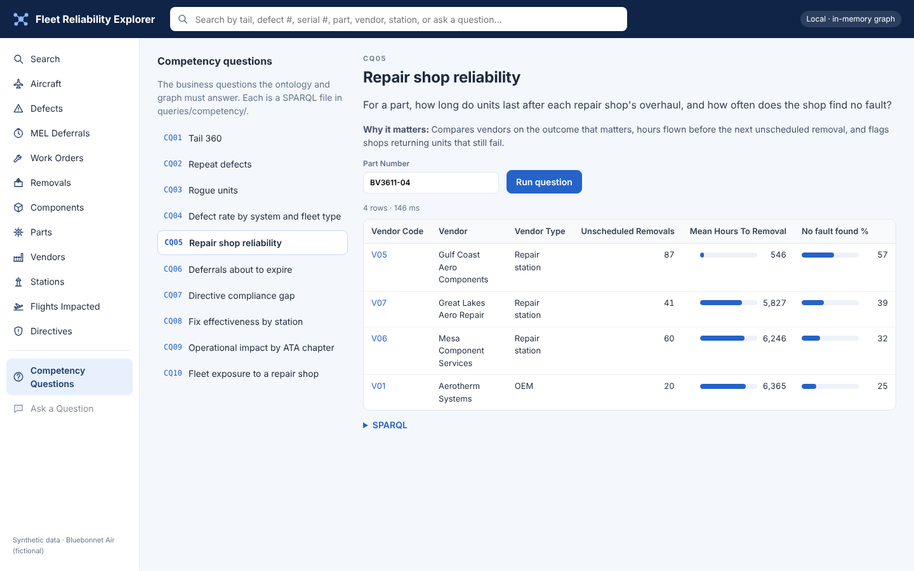

# Fleet Reliability Connectivity Pilot

**One ontology, two engines.** This repository builds an aircraft maintenance reliability pilot
end to end with the **AWS CDK (Python)**:

- a shared **maintenance & engineering ontology** (RDF/OWL, SKOS, SHACL)
- a **knowledge graph on Amazon Neptune Serverless** with a validated load pipeline
- ten **competency questions** in SPARQL
- the **Fleet Reliability Explorer** web app, with optional natural-language search on **Amazon Bedrock**
- an **ontology-driven Delta lakehouse** for **Databricks**: Delta tables, Unity Catalog SQL and metric views, all generated from the same ontology and the same validated records as the graph



> All data is synthetic: one year of operations for 160 Boeing 737s of a fictional airline,
> "Bluebonnet Air" (flights BB…, tails N…BB). Vendors, part numbers and airworthiness directives
> are fictional. Airport codes, aircraft and engine types, and ATA chapter numbers are real
> industry references. Not affiliated with any airline.

**Contents:**
[The use case](#the-use-case) ·
[Architecture](#architecture) ·
[The ontology](#the-ontology) ·
[Competency questions](#the-ten-competency-questions) ·
[The explorer](#the-fleet-reliability-explorer) ·
[Databricks](#the-databricks-lakehouse) ·
[Deploy](#deploy) ·
[Use it](#use-it) ·
[Run locally](#run-locally-without-aws) ·
[Data quality](#data-quality-shacl) ·
[Six weeks](#the-six-weeks) ·
[Tests](#tests-and-ci) ·
[Security](#security) ·
[Cost](#cost-and-teardown) ·
[Layout](#project-layout)

## The use case

Reliability engineers and maintenance control chase the same questions every week. Why does this
tail keep writing up bleed trips? Which serial numbers keep coming off aircraft? Is it the part,
the station's troubleshooting, or the shop that overhauled it? Which tails are flying with the
same risk today, and what has it cost the operation?

The answers sit in separate systems: defects and MEL deferrals, work orders, component
removals and shop findings, airworthiness directives, and the flights delayed. The pilot connects
them through one ontology. The synthetic year contains three findings for the demo to uncover:

1. **Rogue bleed valves.** Bleed air pressure regulating valves overhauled by one repair shop
   fail after about 550 flight hours on average, against about 6,000 for other shops. More than
   half come back "no fault found", and the same serial numbers return to service and fail again.
2. **A station whose fixes don't hold.** Air conditioning (ATA 21) fixes at BWI are followed by
   another ATA 21 write-up within three days 43% of the time.
3. **A chronic tail.** N812BB writes up BLEED TRIP OFF three times in nine days (DF-100245 is
   the middle one). The fault is deferred, a flight is delayed 95 minutes and another is
   cancelled. The unit removed, BV10457, has already come off two other aircraft this year.

## Architecture



The pipeline runs automatically after every deploy that changes the data, ontology, shapes or
code:

```
transform CSV → RDF → SHACL validate ─┬─ graph:     bulk load Neptune → materialize inferences → run the 10 questions
   (violations stop everything)       └─ lakehouse: project ontology-shaped tables → Glue writes Delta → crawler registers
```

| Stack | Contents |
|---|---|
| `FleetKgCoreStack` | VPC (isolated, S3 gateway endpoint, no NAT), Neptune Serverless (IAM auth, encrypted), data bucket, admin and RDF-tools Lambdas, the Step Functions pipeline, the Glue Delta job, Glue database and crawler, an Athena workgroup, and an optional read-only IAM role for a Databricks storage credential |
| `FleetKgAppStack` | Explorer Lambda (in the VPC, read-only), NLQ Lambda (Bedrock), HTTP API (throttled), S3 + CloudFront site with a strict Content-Security-Policy |
| `FleetKgNotebookStack` *(optional)* | Neptune workbench notebook with Graph Explorer |

## The ontology



| File | What it holds |
|---|---|
| [`ontology/fleet.ttl`](ontology/fleet.ttl) | 17 classes (with `Asset`, `MaintenanceRecord`, `Organization` superclasses), relationships with `owl:inverseOf` pairs, attributes, every one labeled and most defined |
| [`reference/ata-chapters.ttl`](reference/ata-chapters.ttl) | SKOS taxonomy: 25 ATA chapters in 3 system groups, and the defect status list |
| [`shapes/fleet-shapes.ttl`](shapes/fleet-shapes.ttl) | SHACL rules: key formats, cardinalities, MEL categories and expiry, work orders not closing before they open, records on the same aircraft as the defect they belong to, directives only accomplished on models they apply to |

Neptune holds four named graphs: ontology (523 triples), reference (190), data (72,740) and
inferred (46,287 triples from [`fleet_kg/rules.py`](fleet_kg/rules.py): inverses, sub-classes,
sub-properties, the transitive taxonomy and the derived `inSystemGroup`).

## The ten competency questions

Each one is a SPARQL file in [`queries/competency/`](queries/competency/), runs in the explorer
and the CLI, and runs after every load.
[Results on the synthetic data](docs/competency-results.md).

| # | Question | What the data shows |
|---|---|---|
| CQ01 | **Tail 360:** open deferrals, recent defects, directives owed and installed units for one aircraft | N812BB: the April bleed trips and its installed units with their last shops |
| CQ02 | **Repeat defects:** 3+ write-ups in one ATA chapter within 10 days | N812BB, ATA 36 Pneumatic |
| CQ03 | **Rogue units:** serials removed 3+ times with short time on wing | 16 units, almost all bleed valves; BV11209 came off 6 aircraft |
| CQ04 | **Defect rate** per 1,000 departures by model and ATA chapter | ATA 36 on the 737 MAX 8 leads |
| CQ05 | **Repair shop reliability** for a part | Gulf Coast Aero Components: 546 mean hours to removal, 57% no fault found |
| CQ06 | **Deferrals about to expire** by a date | 4 open deferrals expiring by Oct 2 |
| CQ07 | **Directive compliance gap** | 21 MAX 8s still owe AD-2026-04-11 |
| CQ08 | **Fix effectiveness by station** | BWI: 43% of ATA 21 fixes followed by a repeat within 3 days |
| CQ09 | **Operational impact** by ATA chapter | ATA 36: 88 flights, 7,970 delay minutes, 11 cancellations |
| CQ10 | **Fleet exposure** to a repair shop | 9 tails flying with bleed valves from that shop, one unit already removed 5 times |

## The Fleet Reliability Explorer



Search any tail, defect, serial number, part, vendor or station. A defect opens at the center of
its graph: the aircraft, station, ATA chapter, MEL deferral, delayed flight and work order, and
further out the removal, the serial-numbered unit and the shop that last repaired it. The
Related Information panel summarizes the defect, and one click shows the aircraft's history in
the same chapter. Click any node to re-center on it. The unit BV10457, for example, shows its
three removals from three different aircraft:



**Competency Questions** runs all ten with editable parameters and shows the SPARQL;
**Ask a Question** turns plain English into SPARQL with Claude Sonnet 4.5 on Bedrock:



## The Databricks lakehouse

The same ontology, projected into Delta tables, so the lakehouse and the graph share one
semantic layer ([full guide](docs/databricks.md)):

- **12 tables, generated from the ontology:** one per class (`dim_aircraft`, `fact_defect`,
  `fact_component_removal`, …), one column per property, keys from business-key properties and
  foreign keys from single-valued relationships ([table model](docs/lakehouse-model.md)).
- **Fed by the same validated data:** rows are projected from the RDF that passed SHACL, then
  AWS Glue writes them as Delta Lake. A crawler registers them in the Glue Data Catalog, so
  Athena can query them too.
- **Generated Unity Catalog SQL:** external tables with the ontology's definitions as comments,
  `ontology_class` / `ontology_property` tags, and informational primary and foreign keys
  ([`databricks/unity_catalog.sql`](databricks/unity_catalog.sql)).
- **Metric views:** Unity Catalog metric views (YAML 1.1) for defects, component removals
  (unscheduled removals, mean hours to removal, no-fault-found rate) and operational impact.
- **Proven equivalent:** [`databricks/competency_questions.sql`](databricks/competency_questions.sql)
  answers CQ03, CQ04, CQ05, CQ08 and CQ09 in SQL, and a test checks that the SQL and the SPARQL
  give identical answers on the same data.
- **Optional IAM role for Databricks:** `-c databricksExternalId=<id>` creates a read-only,
  self-assuming role for a Unity Catalog storage credential.

## Deploy

**Prerequisites:** AWS credentials (`aws sts get-caller-identity`), Python 3.11+, Node.js 18+,
the CDK CLI (`npm install -g aws-cdk`), and internet access at synth time (pip fetches rdflib and
pySHACL for one Lambda; no Docker). For natural-language search, access to Claude Sonnet 4.5 in
Amazon Bedrock.

```bash
git clone https://github.com/mickemora/fleet-reliability-knowledge-graph
cd fleet-reliability-knowledge-graph
python3 -m venv .venv && source .venv/bin/activate
pip install -r requirements-dev.txt

export CDK_DEFAULT_ACCOUNT=$(aws sts get-caller-identity --query Account --output text)
export CDK_DEFAULT_REGION=$(aws configure get region)

cdk bootstrap            # once per account and region
cdk deploy --all         # about 20 minutes, mostly Neptune
python scripts/kg.py status    # the pipeline starts by itself; wait for SUCCEEDED
open "$(python scripts/kg.py url)"
```

| Context key | Default | Effect |
|---|---|---|
| `lakehouse` | `true` | Glue Delta export, Glue database and crawler, Athena workgroup, Unity Catalog SQL (`false` to skip) |
| `glueDatabase` | `fleet_reliability` | Glue Data Catalog database name |
| `databricksExternalId` | none | Creates the read-only IAM role for a Databricks storage credential ([guide](docs/databricks.md)) |
| `nlq` | `true` | Natural-language search with Amazon Bedrock |
| `nlqModelId` | `global.anthropic.claude-sonnet-4-5-20250929-v1:0` | Any Bedrock model or inference profile that supports Converse; `us.anthropic.claude-sonnet-4-5-20250929-v1:0` keeps inference in US regions |
| `notebook` | `false` | Neptune workbench notebook with Graph Explorer |
| `autoLoad` | `true` | Run the pipeline on deploys that change data, ontology, shapes or code |
| `minNcu` / `maxNcu` | `1` / `8` | Neptune Serverless capacity |
| `neptuneEngineVersion` | `1.4.7.1` | Neptune engine version |

## Use it

```bash
python scripts/kg.py pipeline                 # rerun: validate → graph ∥ lakehouse
python scripts/kg.py report                   # latest SHACL data-quality report
python scripts/kg.py cq run cq05
python scripts/kg.py cq run cq10 --param vendorCode=V05 --param shopFrom=2026-01-01
python scripts/kg.py nlq "Which stations had the most bleed trip defects?"
python scripts/kg.py athena "SELECT after_repair_by, AVG(hours_since_install) AS h FROM fact_component_removal GROUP BY 1 ORDER BY 2"
python scripts/kg.py lakehouse                # Unity Catalog SQL + metric views for your bucket
python scripts/kg.py diagnose
```

## Run locally without AWS

```bash
pip install -r requirements-dev.txt
python scripts/serve_local.py                 # http://localhost:8765
python scripts/kg.py cq run cq03 --local
python scripts/kg.py validate --local
```

The local server runs the same mapping, rules, API and UI on an in-memory graph (rdflib).

## Data quality (SHACL)

The clean dataset conforms with 0 violations. To see the rules work:

```bash
python -m datagen.generate --inject-defects --out /tmp/fleet-defects
python scripts/kg.py validate --local --raw /tmp/fleet-defects/raw
```

All eight injected defects are caught: a deferral that expires the day it was made, MEL
category X, a work order closed before it opened, a work order on the wrong aircraft, negative
hours since install, ATA chapter 99, a malformed defect number, and an unknown home base. In
AWS the same data stops the pipeline before **either** Neptune or the lakehouse is written.

## The six weeks

| Week | Deliverables | In this repository |
|---|---|---|
| 1 Business discovery | Problem statement, competency questions, plan | [playbook](docs/pilot/README.md#week-1-business-discovery), `queries/competency/` |
| 2 Ontology modeling | Conceptual model, RDF/OWL/SHACL, glossary | `ontology/`, `reference/`, `shapes/`, [glossary](docs/pilot/README.md#week-2-ontology-modeling) |
| 3 Graph and lakehouse | Neptune graph, Delta tables, data quality report | `datagen/`, `fleet_kg/`, `glue/`, core stack |
| 4 Query and validation | 10 validated questions, results, sign-off | [results](docs/competency-results.md), `databricks/competency_questions.sql` |
| 5 User experience | Explorer, workflows, NLQ, metric views | `frontend/`, app stack, `databricks/metric_views/` |
| 6 Demo and evaluation | Demo, impact, lessons, next phase | [demo script](docs/pilot/README.md#week-6-demonstration-and-evaluation) |

## Tests and CI

```bash
pytest -q
```

Covers the generator and its planted signals; ontology, taxonomy and SHACL (clean data conforms,
every injected defect is caught); materialization rules and all ten competency answers; the
explorer API; the read-only SPARQL guard and NLQ with Bedrock stubbed; the Lambda handlers with
Neptune and S3 faked; the lakehouse model, generated SQL and metric views, **graph versus
lakehouse parity**; and the CDK templates. CI also runs `cdk synth --all`, compiles the Glue
script and smoke-tests the local explorer.

## Security

- Neptune is in isolated subnets with IAM auth and encryption; only the admin and explorer
  functions can reach it, and the explorer can only read.
- Free-text queries (NLQ, CLI) pass a read-only guard (no updates, no `SERVICE`), and parameters
  are validated against patterns.
- CloudFront serves the UI over HTTPS with a strict CSP; the API is throttled.
- The Databricks role can only read `lakehouse/delta/` and only Unity Catalog with your external
  ID can assume it.
- **The explorer has no sign-in.** Fine for synthetic data; add Cognito and AWS WAF before
  real data.

## Cost and teardown

Neptune Serverless bills at its minimum capacity (1 NCU) every hour the cluster exists. Glue
bills per run (2 workers for a couple of minutes per pipeline run); Athena per query. The rest is
pay-per-use and small. See [Neptune](https://aws.amazon.com/neptune/pricing/) and
[Glue](https://aws.amazon.com/glue/pricing/) pricing.

```bash
cdk destroy --all
```

This deletes everything, including the Delta tables in the data bucket. Drop the Unity Catalog
tables in Databricks too (`DROP SCHEMA fleet_reliability.maintenance CASCADE`).

## Project layout

```
app.py                         CDK app
infra/                         core (Neptune, pipeline, lakehouse), app (explorer), notebook stacks
ontology/ reference/ shapes/   the ontology (OWL), ATA taxonomy (SKOS), business rules (SHACL)
queries/competency/            the ten competency questions (SPARQL)
datagen/                       synthetic fleet maintenance generator
fleet_kg/                      shared library: mapping, validation, rules, SPARQL clients,
                               competency runner, explorer API, NLQ, lakehouse projection
functions/                     Lambda handlers: admin, rdf_tools, explorer_api, nlq
glue/delta_export.py           Glue Spark job that writes the Delta tables
databricks/                    Unity Catalog SQL, metric views, competency questions in SQL (generated)
frontend/                      Fleet Reliability Explorer (no dependencies)
scripts/                       CLI, local server, asset bundling, generators
docs/                          pilot playbook, Databricks guide, lakehouse model, results, images
tests/                         pytest suite
```
