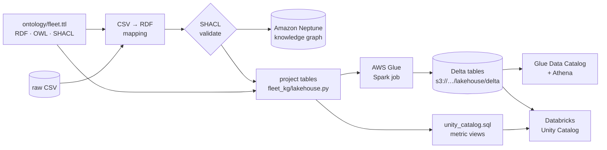

# One ontology, two engines: the graph and the Databricks lakehouse

**The talking point.** A shared ontology isn't a graph-only idea. In this pilot the same
`ontology/fleet.ttl` drives two physical models:

| | Knowledge graph | Lakehouse |
|---|---|---|
| Engine | Amazon Neptune (RDF, SPARQL) | Delta Lake on S3, readable by Databricks (and Athena) |
| Built from | the SHACL-validated RDF | **the same** SHACL-validated RDF, projected into tables |
| Structure | classes, relationships, inverses, taxonomy | one table per class, one column per property, keys from relationships |
| Definitions | `skos:definition`, `rdfs:label` | Unity Catalog table and column `COMMENT`s |
| Lineage | IRIs | Unity Catalog tags `ontology_class`, `ontology_property` |
| KPIs | competency questions (SPARQL) | the same questions in SQL, plus Unity Catalog **metric views** |
| Best at | multi-hop exploration: defect → work order → removal → unit → shop → other tails | aggregates, BI dashboards, ML features, Genie |

So the ontology becomes the semantic layer for both. Change a definition once and the graph,
the Delta tables, the Unity Catalog comments and the metric views all follow. The test suite
proves the two engines agree: `tests/test_lakehouse.py` runs the Databricks SQL for CQ03, CQ05,
CQ08 and CQ09 and the SPARQL versions on the same data and checks the answers are identical.



## What gets generated

| File | What it is |
|---|---|
| `s3://<data bucket>/lakehouse/delta/<table>/` | 12 Delta tables written by the Glue job (`glue/delta_export.py`), rewritten on every pipeline run |
| Glue database `fleet_reliability` | Native Delta tables registered by the Glue crawler; query them with Athena (`python scripts/kg.py athena "SELECT …"`) |
| `s3://<data bucket>/lakehouse/databricks/unity_catalog.sql` | Creates the catalog, schema and external tables in Unity Catalog, with comments, tags, primary keys and foreign keys, using your bucket's location |
| `…/lakehouse/databricks/metric_views/*.sql` | Unity Catalog metric views (YAML 1.1): `mv_defects`, `mv_component_removals`, `mv_operational_impact` |
| [`databricks/`](../databricks/) in this repo | The same files with a placeholder location, plus [`competency_questions.sql`](../databricks/competency_questions.sql) |
| [`docs/lakehouse-model.md`](lakehouse-model.md) | The table model: every table, column, type, key and the ontology term it came from |

`python scripts/generate_databricks.py` regenerates the repo copies after an ontology change (a
test fails if you forget).

## Connect Databricks to the Delta tables

You need a Databricks workspace on AWS with Unity Catalog, and permission to create a storage
credential and an external location (a metastore admin, or the matching privileges).

1. **Deploy and run the pipeline** (lakehouse is on by default):

   ```bash
   cdk deploy --all
   python scripts/kg.py status                 # wait for SUCCEEDED
   python scripts/kg.py athena "SELECT COUNT(*) AS n FROM fact_defect"   # optional check
   ```

2. **Create a storage credential in Databricks.** In Catalog Explorer: **External data →
   Credentials → Create credential → AWS IAM role**. Enter the role ARN you are about to create:
   `arn:aws:iam::<your account>:role/FleetKgCoreStack-databricks-uc`. Databricks shows an
   **external ID**; copy it.

3. **Create that role with CDK.** It trusts Unity Catalog's role with your external ID, trusts
   itself (Databricks requires self-assuming roles) and can only read `lakehouse/delta/`:

   ```bash
   cdk deploy FleetKgCoreStack -c databricksExternalId=<external ID from step 2>
   ```

   Back in Databricks, open the credential and choose **Validate configuration**. The read checks
   pass; write and delete checks fail by design, because the role is read-only.

4. **Create an external location** for `s3://<data bucket>/lakehouse/delta` with that credential
   (`python scripts/kg.py lakehouse` prints the exact path). Mark it read-only.

5. **Register the tables and metric views.** Download the generated SQL and run it in a SQL
   warehouse or notebook:

   ```bash
   python scripts/kg.py lakehouse          # writes databricks-deployed/unity_catalog.sql and metric_views/
   ```

   Run `unity_catalog.sql`, then each file in `metric_views/`. If your workspace can't create a
   catalog, change `fleet_reliability` to an existing catalog at the top of the files.
   Metric views need a recent Databricks runtime or SQL warehouse (see the Databricks metric view
   documentation).

6. **Ask the same questions.** Run [`databricks/competency_questions.sql`](../databricks/competency_questions.sql),
   or query a metric view:

   ```sql
   SELECT `Repaired By`, MEASURE(`Mean Hours To Removal`), MEASURE(`No Fault Found Rate`)
   FROM fleet_reliability.maintenance.mv_component_removals
   WHERE `Part` LIKE 'BV3611-04%'
   GROUP BY ALL;
   ```

   Gulf Coast Aero Components stands out at about 550 mean hours to removal against roughly
   6,000 for the other shops: the same finding as competency question CQ05 in the explorer.

Because the pipeline rewrites the Delta tables on every run, Databricks always sees the data
that passed SHACL validation, with the same keys the graph uses.

## How to talk about it

- **"Isn't this a second copy?"** It's a second *physical model* of one *logical model*. Neither
  is hand-built: both are generated from the ontology and fed by the same validated records, and
  a test checks that they answer the same questions identically.
- **"Why not only Databricks?"** Aggregates and dashboards belong in the lakehouse. Following a
  defect through a work order to a serial number, to the shop that repaired it, to the other tails
  that unit flew on, and to the flights it delayed is a graph traversal; the explorer does it in
  one click.
- **"Why not only the graph?"** BI tools, Genie, notebooks and ML pipelines live in Databricks.
  The ontology's definitions arrive there as comments, tags, keys and governed metrics, so
  analysts use the same vocabulary as engineering.
- **"Can the ontology live in Unity Catalog instead?"** Partly: the generated tags and comments
  put the ontology's terms on every table and column, and the metric views carry the KPI
  definitions. The OWL file stays the source of truth because it also holds relationships,
  inverses, the taxonomy and the SHACL rules that tables can't express.
